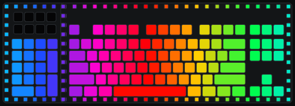
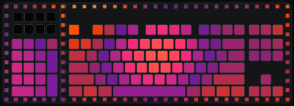
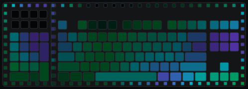
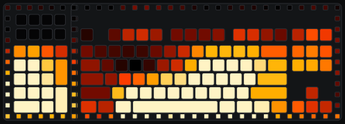
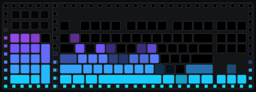
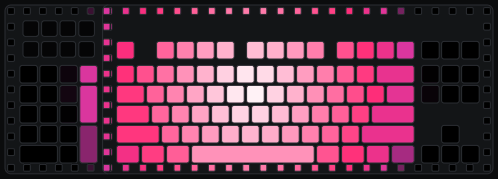
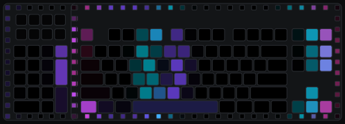
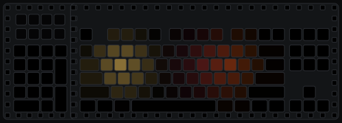

# Dark Mount Studio

Custom RGB lighting for the be quiet! Dark Mount keyboard: 74 effects, including ones that react to
sound and to typing, run by a small Windows tray app and set up in a page in your browser.

The keyboard can only store its eight built-in effects, so anything else has to be sent to it by a
program that keeps running. Dark Mount Studio is that program: a tray app of about 1 MB that draws
the effects 30 times a second. The settings page only changes settings, so you can close the tab
and the lights carry on.

This is an unofficial hobby project. It is not affiliated with or endorsed by be quiet! / Listan.

## What it does

- **74 effects in six groups**: Static, Motion, Nature, Pulse, Audio and Typing.
- **Audio effects** follow whatever is playing on the PC, on whichever output device is in use,
  and change colours on the beat.
- **Typing effects** react to key presses on the Dark Mount itself.
- **Paint**: colour single keys by hand and save the result as a preset.
- **Layers**: split the lights into groups and run a different effect on each one.
- **Live preview** of the whole board, with the numpad module on either side, in step with the
  keyboard.
- Lights the keys, the edge bars and the numpad module, each of which can be switched off.
- Hands the lights back to the keyboard's own effect when it is switched off, exits, or (for audio
  effects) when nothing is playing.

## A few of the effects

<table>
<tr>
<td><br><b>Wave</b> · Motion</td>
<td><br><b>Plasma</b> · Motion</td>
</tr>
<tr>
<td><br><b>Aurora</b> · Nature</td>
<td><br><b>Fire</b> · Nature</td>
</tr>
<tr>
<td><br><b>Audio spectrum</b> · Audio</td>
<td><br><b>Audio bloom</b> · Audio</td>
</tr>
<tr>
<td><br><b>Key ripple</b> · Typing</td>
<td><br><b>Key splash</b> · Typing</td>
</tr>
</table>

These are drawn by the settings page's own preview code (`npm run gifs` in `web/`). The audio effects
are playing a made-up song and the typing effects watch made-up typing.

## Requirements

- Windows (tested on Windows 11)
- [.NET 8 Desktop Runtime](https://dotnet.microsoft.com/download/dotnet/8.0)
- A be quiet! Dark Mount (USB `373F:0001`)

## Install and run

1. Download `DarkMountStudio-vX.Y.Z.zip` from the
   [latest release](https://github.com/drumslave-git/dark-mount-rgb-studio/releases/latest).
2. Unzip it anywhere you can write to, for example `D:\Tools\DarkMountStudio`.
3. Start `DarkMountStudio.exe`. An icon appears in the tray:
   - **Double-click** the icon, or choose **Open settings**, to open the page at
     <http://localhost:4173>.
   - **Enabled** switches the effects on and off.
   - **Start with Windows** adds or removes the app from your startup programs.

If Windows *Dynamic Lighting* is switched on for the keyboard, switch it off. It competes for the
same lights.

### Portable

The app is one exe with the settings page inside it. It saves its settings in `settings.json` next
to the exe and keeps nothing anywhere else: no AppData folder, no browser storage, no installer.

- To move it, move the folder. To back it up, copy `settings.json`.
- To update, replace `DarkMountStudio.exe` with the one from the new release.
- To remove it, untick **Start with Windows**, exit, and delete the folder.

**Start with Windows** is the one exception: ticking it adds an entry for the exe to your startup
programs in the registry, and unticking it removes the entry. If you move the folder, the entry
follows the next time you start the app.

## Build

With the .NET SDK 8 or later and Node.js 22.18 or later:

```bash
cd tray
dotnet publish -c Release -o publish
```

This builds the settings page in `web/` (installing its npm packages the first time), embeds it
and writes `tray/publish/DarkMountStudio.exe`.

## How it works

```
 browser tab (web/, React)              tray app (tray/, C#)             keyboard
 settings + preview  ── HTTP, JSON ──▶  settings, effects, audio,  ── HID LampArray ──▶  201 lights
                        localhost:4173  key watching, 30 fps
```

- The keyboard exposes a standard HID LampArray interface. The tray app takes control of it and
  sends every frame over USB with [HidSharp](https://www.zer7.com/software/hidsharp).
- Sound is captured from the output device with WASAPI loopback
  ([NAudio](https://github.com/naudio/NAudio)) and turned into 32 frequency bands plus a beat count.
- Key presses come from Windows Raw Input, filtered to the Dark Mount, and only while a typing
  effect is selected. They are used for the lights and nothing else: never logged, saved or sent
  anywhere.
- The page is served on loopback only, and the server refuses requests that come from other sites.
- The effects exist twice: `web/src/lib/effects.ts` draws the preview and `tray/Effects*.cs` drives
  the keyboard. The two give the same numbers for the same moment.
- The page is written in TypeScript with React and Tailwind CSS and built with Vite into three
  static files, which are embedded in the exe. It loads nothing from the network.

### Layout

| Path | What it is |
| --- | --- |
| `web/index.html`, `web/src/main.tsx`, `web/src/App.tsx` | The settings page |
| `web/src/components/` | Its parts: toolbar, effect list, effect settings, layer editor, keyboard picture |
| `web/src/index.css` | Tailwind and the page's colours |
| `web/src/store.ts`, `web/src/settings.ts`, `web/src/actions.ts` | The page's copy of the settings and everything that changes them |
| `web/src/tray.ts`, `web/src/clock.ts` | Talking to the tray app and keeping its time |
| `web/src/preview.ts` | Drawing the preview, painting, picking a layer's lights |
| `web/src/lib/effects.ts` | All effects, palettes and their parameters (preview copy) |
| `web/src/lib/layers.ts` | Layered presets |
| `web/src/lib/geometry.ts`, `web/src/lib/layout.ts`, `web/src/lib/board.ts` | Where each light sits and the keyboard's lamp table |
| `web/scripts/frame.ts` | Prints one frame of the preview, for comparing with `--dump-frame` |
| `web/scripts/gifs.ts`, `docs/effects/` | Renders effects as looping GIFs, and the ones shown in this README |
| `tray/Program.cs` | Entry point and command line |
| `tray/Engine.cs` | The loop that renders and sends frames |
| `tray/Effects.cs`, `tray/EffectsMore.cs`, `tray/Palette.cs`, `tray/Renderer.cs` | C# port of the effects and layers |
| `tray/Keyboard.cs` | HID LampArray access |
| `tray/AudioCapture.cs`, `tray/Spectrum.cs` | Sound capture, frequency bands, beat detection |
| `tray/KeyWatcher.cs` | Key presses for the typing effects |
| `tray/HttpServer.cs`, `tray/Settings.cs` | The page server, its API and the saved settings |
| `tray/TrayApp.cs` | Tray icon and menu |
| `tray/SelfTest.cs` | `--selftest` |
| `.github/` | The release workflow and the script that works out the next version |

### Command line

| Command | What it does |
| --- | --- |
| `DarkMountStudio.exe` | Runs the tray app (one instance only) |
| `DarkMountStudio.exe --site <folder>` | Same, but serves a built page from disk (`web/dist`) instead of the embedded one |
| `DarkMountStudio.exe --exit` | Asks the running tray app to quit cleanly |
| `DarkMountStudio.exe --selftest` | Checks the keyboard, audio and the HTTP API and prints a report |
| `DarkMountStudio.exe --audio-devices` | Lists the output devices and which one would be listened to |
| `DarkMountStudio.exe --dump-frame <effect> <seconds> [settings JSON] [beats]` | Prints one rendered frame as JSON, for comparing with `web/src/lib/effects.ts` |
| `DarkMountStudio.exe --version` | Prints the version (`dev` for a local build) |

Stop the app with **Exit** in the tray menu or with `--exit`. If the process is killed instead, the
lights stay frozen on the last frame.

### HTTP API

| Request | Answer |
| --- | --- |
| `GET /api/state` | `{ settings, status, clock, instance }` |
| `PUT /api/state` | Takes any part of the settings object, answers like `GET` |
| `GET /api/levels` | `{ levels: [32 numbers], beat }` |

## Working on it

With the tray app running, start the page's dev server:

```bash
cd web
npm install
npm run dev
```

It serves the page on <http://localhost:5173> with hot reload and passes the API calls on to the
tray app, so changes in `web/src` show up at once. Publish again to embed them in the exe.
`npm run build` type-checks the page and builds it into `web/dist`.

When you change an effect, change it in both `web/src/lib/effects.ts` and the C# port, then compare
one frame from each. They take the same arguments and must print the same bytes:

```bash
cd web
npm run --silent frame -- wave 1
../tray/publish/DarkMountStudio.exe --dump-frame wave 1
```

To redraw the GIFs at the top of this page, name the effects (optionally with a length in
seconds, `aurora:6`):

```bash
cd web
npm run gifs -- ../docs/effects wave plasma aurora fire audio audiobloom keyripple keysplash
```

### Releases

Releases are automatic. Every push to `main` that changes the app (`tray/` or `web/`) runs [the release workflow](.github/workflows/release.yml), which builds the exe,
checks that it starts, and publishes a GitHub release with the zip.

The version number is automatic too. It is taken from the last `vX.Y.Z` tag and the commit messages
since then:

| Commit message | Raises | Example |
| --- | --- | --- |
| `feat: ...` | minor | 1.2.3 → 1.3.0 |
| `feat!: ...`, `fix!: ...` or a `BREAKING CHANGE:` line | major | 1.2.3 → 2.0.0 |
| anything else | patch | 1.2.3 → 1.2.4 |

To release without a code change, or to choose the number yourself, run the workflow by hand under
**Actions → Release → Run workflow**. The version of a running copy is the first line of its tray
menu.

## License

[MIT](LICENSE). The exe includes [HidSharp](https://www.zer7.com/software/hidsharp) (Apache 2.0),
[NAudio](https://github.com/naudio/NAudio) (MIT), [React](https://react.dev) (MIT) and base styles
from [Tailwind CSS](https://tailwindcss.com) (MIT); see [THIRD-PARTY-NOTICES.txt](THIRD-PARTY-NOTICES.txt).
